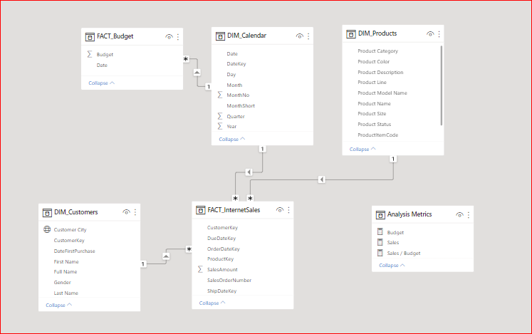
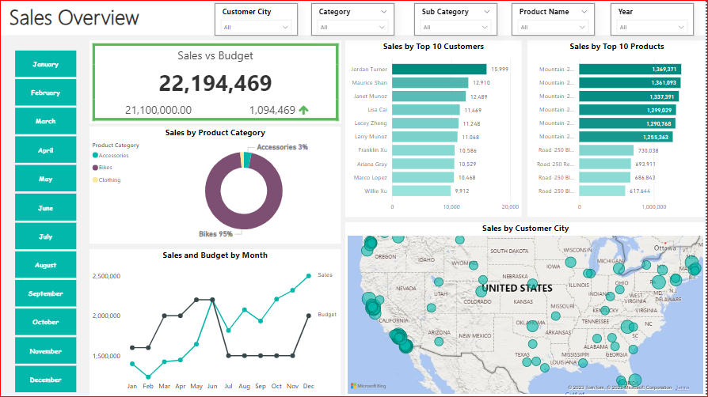
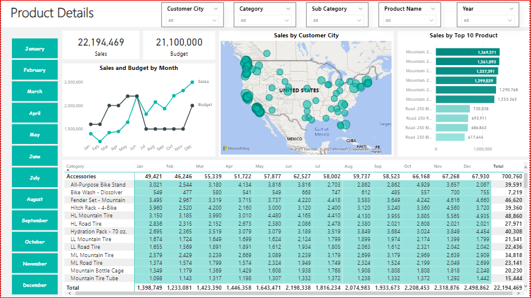
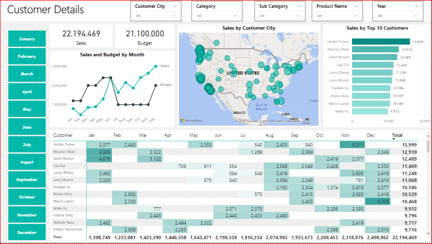

# AdventureWorksDW2019 – Data Modeling & Power BI Analysis

An end-to-end BI project built on the **AdventureWorksDW2019** sample data warehouse: extracting and cleaning data with SQL, building a data model, and delivering three interactive **Power BI** dashboards covering sales, products, and customers.

---

## Project Workflow

1. **Extract** – Pulled the required tables from `AdventureWorksDW2019_DatesUpdated` using SQL scripts.
2. **Clean & Transform** – Prepared the data in SQL:
   - Converted `Timestamp` columns to `Date`
   - Concatenated name fields into a single full name
   - Rounded salary values
3. **Model** – Built a data model in Power BI linking the fact table to the dimension tables (see the diagram below).
4. **Visualize** – Designed three dashboards, each answering a different business question.

---

## Tools

- **SQL Server** (SQL scripts for extraction and cleaning)
- **Power BI** (data modeling, DAX, dashboards)
- **Excel** (sales budget data)

---

## Data Model

<p align="center">
  
</p>

| Table | Type | Source files |
|---|---|---|
| Internet Sales | Fact | `InternetSales.sql`, `InternetSales.csv` |
| Calendar | Dimension | `DIM_Calender.sql`, `DIM_Calender.csv` |
| Customer | Dimension | `DIM_Customer.sql`, `DIM_Customer.csv` |
| Product | Dimension | `Product.sql`, `Product.csv` |
| Sales Budget | Budget | `SalesBudget.xlsx` |

---

## Dashboards

### 1. Sales Overview
<p align="center">
  
</p>

- KPIs comparing **actual sales vs. budget**
- **Top 10 products** and **top 10 customers**
- Sales by **city in the US**, highlighting the top-performing city
- Sales by category – **Bikes** is the top-selling category

### 2. Product Details
<p align="center">
  
</p>

- Consolidated view of product **ordering and shipping** information

### 3. Customers
<p align="center">
  
</p>

- Focus on **customer status**, **salary**, and **job type**

---

## Key Insights

- **Bikes** generate the highest sales among all product categories.
- Sales performance is tracked against budget through dedicated KPIs.
- Top products, top customers, and the top-selling US city are identified in the Sales Overview dashboard.

---

## Repository Structure

```
├── DIM_Calender.sql / .csv     # Date dimension
├── DIM_Customer.sql / .csv     # Customer dimension
├── InternetSales.sql / .csv    # Sales fact table
├── Product.sql / .csv          # Product dimension
├── SalesBudget.xlsx            # Budget data
├── DataModel.PNG               # Data model diagram
├── Sales1.PNG                  # Sales Overview dashboard
├── product1.PNG                # Product Details dashboard
└── customer1.PNG               # Customers dashboard
```

---

## How to Reproduce

1. Restore the **AdventureWorksDW2019** database in SQL Server.
2. Run the `.sql` scripts to extract and clean each table (or use the provided `.csv` files directly).
3. Open Power BI and import the tables along with `SalesBudget.xlsx`.
4. Create the relationships shown in the data model diagram.
5. Build the visuals and KPIs as shown in the dashboard screenshots.

---

## Author

**Marwa** – [GitHub](https://github.com/marwa23-rgb)
